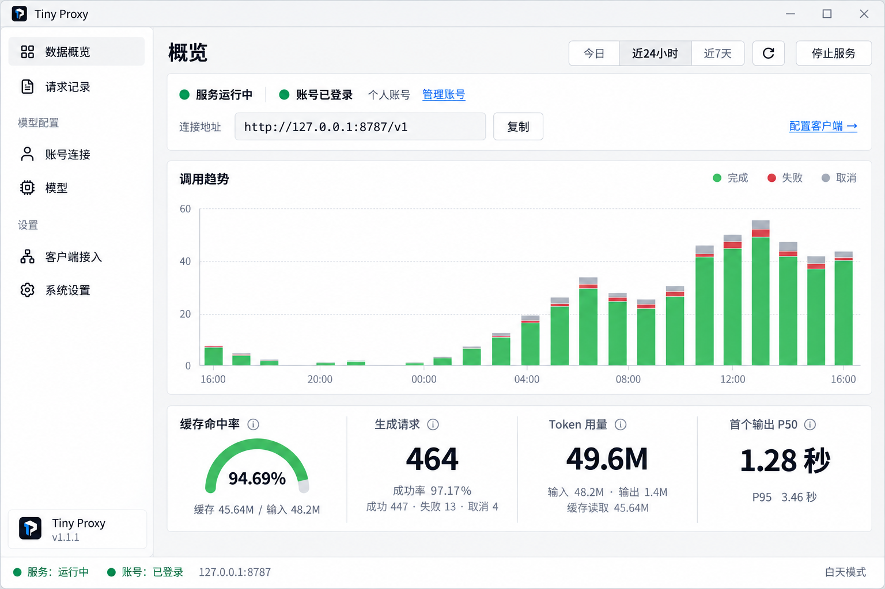

# 首页统计与预览落地

状态：Review（视觉与实施范围已批准，运行验收待执行）  
最后更新：2026-10-14  
关联文档：[视觉系统](visual-system.md)、[验收场景](../01-requirements/acceptance/mvp.md)、[桌面检查清单](../04-quality/desktop-redesign-checklist.md)

## 批准依据与布局

用户在上一版首页基础上明确要求“缓存命中率用真实数据，左侧菜单按图分组，首页去掉最近请求，布局要和预览图一致”。下图为本轮批准的设计目标，替代[上一版含最近请求的首页预览](previews/overview-statistics-light.png)；图片中的数字是演示，不能作为程序运行证据。其他页面和主题仍遵循现有 hashicorp 桌面适配，品牌沿用本项目“中继之门”。

- 页头：概览标题、今日/近24小时/近7天、刷新、启动/停止服务。默认近24小时，筛选只保存在当前窗口。
- 连接栏：真实服务与账号状态、当前账号、账号管理、实际监听地址、复制和客户端配置入口。
- 调用趋势：按时段堆叠完成、失败、取消；有进行中请求时增加对应图例。原生控件绘制，悬停查看实际分桶计数，空桶不画虚构柱子。
- 统计条：半圆缓存命中率、生成请求、Token 用量、首个输出 P50，四列共用一个182px高面板。成功率并入生成请求下方，缓存读取并入 Token 下方；口径和精确计数放在提示中。
- 首页删除最近请求与“查看全部”，扩大趋势图（绘图区228px高）；请求明细仍通过左侧“请求记录”进入，保留原有详情、分页与搜索功能。
- 左侧顶部为“数据概览、请求记录”；“模型配置”组为“账号连接、模型”；“设置”组为“客户端接入、系统设置”。页码身份不随视觉排序改变，只有当前页面高亮。底部按新预览放置自有图标、Tiny Proxy 和真实应用版本，顶部不增设品牌块。
- 中性边框按钮、灰色选择与 hover/active，绿色用于状态、柱子和缓存仪表；夜间使用相同结构及既有深色配色。
- 无首页请求表后，初始窗口布局尺寸恢复为1280×820，最小960×640。连接栏输入40px高、面板间隔12px，主内容纵向滚动；请求页宽表格保留横向滚动，地址省略显示但复制完整值，长次要统计可省略并悬停查看。

## 数据口径（本轮实现定义）

SQLite 保存的请求元数据与网关实际在途记录是唯一来源；UI 通过后台概览命令读取，不直接执行 SQL、不发模型请求、不读取凭据。查询覆盖整个选定区间的保留记录，不复用每页100条的诊断列表。按请求 ID 去重，在途快照不覆盖已提交的结束记录。

| 项目 | 规则 |
|---|---|
| 生成请求 | 只计 POST `/v1/responses`、`/v1/chat/completions`，按开始时间纳入；包含完成、失败、取消及进行中，排除目录 GET |
| 时间区间 | `[开始时间, 本次查询时间)`；今日按电脑当地日期零点起算，图表保留当天剩余空时段；近24小时为精确24小时，近7天为精确168小时 |
| 分桶 | 今日、近24小时每小时一桶；近7天每6小时一桶，悬停显示该桶起止时间；所有时间显示为电脑当地时间 |
| 成功率 | 完成 ÷（完成 + 失败），分母为零显示未知；失败含不完整、断流与恢复中断，HTTP 200 不代表完成；取消及进行中不参与分母 |
| 缓存命中率 | 从上游 `usage.input_tokens_details.cached_tokens` 或转换后的 Chat `usage.prompt_tokens_details.cached_tokens` 读取真实缓存输入数。仅使用输入与缓存均为非负整数且缓存不超过输入的成对样本，计算 `Σ缓存 / Σ同批输入`，不平均单请求百分比，不混入未知记录的输入。零缓存有效，分母为零、无有效样本或整数合计溢出时为 `—` |
| 缓存覆盖 | 部分已知时仪表旁明确显示“有效样本 n / N”，提示中给出精确分子、同批分母与覆盖数；旧记录不参与比例，也不被当成0%命中。Token 栏的缓存读取在覆盖不全时标为 `≥` 下限 |
| Token | 合计真实输入/输出值；零值保留，负值或缺失按未知。全未知显示 `—`；部分已知显示 `≥` 下限，并提示完整样本数；无请求时合计为0。缓存读取是输入的子集，已包含在总用量内，不再重复相加，也不补造费用 |
| 首个输出 | 仅已观察到首个输出的流式请求，计算 `first_output_at - started_at`；缺失/负耗时不入样本，零耗时有效，不用首字节或全程耗时代替 |
| P50 / P95 | 最近秩 `ceil(样本数 × 百分位) - 1`；未观察到样本显示 `—`，提示样本数 |
| 保留范围 | 沿用本地清理规则：已结束请求最多7天或10000条；统计只代表仍保留的记录，不能宣称终身累计，提示中明确限制 |

本轮新增迁移 `0009_request_cache_tokens.sql`，仅向请求元数据表添加可空 `cached_input_tokens`；旧值保持 NULL，不回填、不重放历史请求。新请求通过现有检查点与结束事务保存。详情与复制可查看该字段，旧记录显示未提供；升级后不支持用缺少0009的旧代码打开同一数据库。迁移与保留边界见[数据模型](../03-architecture/data-model.md#0009-缓存输入-token-元数据)。没有新增依赖。

`src/overview.rs` 定义纯聚合规则，`src/storage/overview.rs` 查询 SQLite，应用后台返回带请求 ID 和时段的独立回执，桌面模块负责展示；缓存采集不增加上游请求、不改变客户端协议或登录行为。

## 刷新与基础操作

进入概览首次读取；停留在概览时每次回执完成后间隔5秒自动刷新，离开概览不继续周期查询。手动刷新在等待期间禁用重复提交，提示上次成功查询时间。

切换时段立即清空旧时段统计并显示读取状态；请求 ID 与时段同时匹配才能更新页面，迟到的旧回执不切回旧数据。同一时段刷新失败保留上次结果并明确标记失败，可手动重试；入队失败解除等待，自动重试仍遵守5秒间隔。错误采用独立回执，不能清除其他操作的等待或错误。

启停使用概览与客户端接入共用的服务控件：停止状态可启动、运行状态可停止，使用现有监听配置；等待中显示“启动中/停止中”并防止连点，失败后恢复可重试。缺账号/密钥有禁用原因和配置入口。重复启动已运行服务也回传真实状态，重复停止同样回传停止状态，不创建第二个监听或重写成功配置。

## 验证边界

保留既有区间/全量查询/刷新回执回归，本轮增加缓存加权、未知/零/异常/溢出、有效样本覆盖、在途去重、旧库升级与重开、检查点不可覆盖终态、两个端点的流式/非流式采集及菜单目标映射回归代码。旧迁移校验值仍逐项保留，新迁移校验值仍必须为规范 LF；没有删掉历史一致性断言。

按根 AGENTS 的默认限制，本轮不执行会编译的测试、构建或应用启动。仅在内存 SQLite 检查新建及升级 SQL，不修改真实数据库；未以设计图或源码检查代替实际窗口验证。建议命令及真实操作场景集中于[桌面检查清单](../04-quality/desktop-redesign-checklist.md)。
