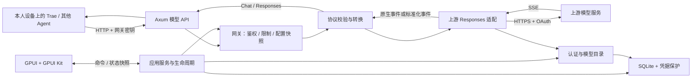

# 整体架构

状态：Review  
最后更新：2026-10-13  
关联文档：[技术栈 ADR](adr/0001-desktop-stack.md)、[认证](authentication.md)、[API](api-contracts.md)、[开发计划](../06-delivery/development-plan.md)

## 结构

推荐一个桌面进程、一个 Cargo package，内部按职责拆模块。GPUI 主事件循环管理窗口，独立后台线程持有 Tokio 多线程运行时；Axum 运行在该运行时内。不是两个可独立部署的产品。



## 目标目录（已开始分阶段创建）

```text
tiny-proxy/
├─ Cargo.toml                 # 单个 package，库入口供测试，桌面二进制入口
├─ Cargo.lock                 # 固定可复现依赖
├─ src/
│  ├─ main.rs                 # 组装、单实例、GPUI 主循环
│  ├─ lib.rs                  # 暴露可测试业务模块
│  ├─ app/                    # 命令、状态、配置快照、启动与关闭
│  ├─ desktop/                # 页面、向导、托盘、主题；只操作应用服务
│  ├─ auth/                   # OAuth、权限状态、续期与退出
│  ├─ gateway/                # Axum 路由、密钥鉴权、限制、错误外壳
│  ├─ protocol/               # 请求映射、SSE 帧、事件状态机、Chat 编码
│  ├─ upstream/               # 固定上游端点、模型目录、Responses HTTP
│  ├─ storage/                # SQLite 查询、事务、版本迁移
│  └─ platform/               # Windows 凭据保护、单实例、系统集成
├─ migrations/               # SQL schema 迁移（实施阶段创建）
├─ tests/
│  ├─ fixtures/               # 合成或脱敏协议样本
│  └─ integration/            # 真实端口 + fake 上游 + SQLite 集成测试
├─ docs/                      # 本轮已创建的方案
└─ .github/workflows/         # 后续 Windows CI
```

不为了将来支持服务端而提前拆独立服务、IPC、插件宿主或多 crate 体系。协议和业务模块避免依赖 GPUI，未来是否独立部署另行评审。

当前 P0 已创建 app、desktop、auth、protocol、storage、platform 及首个 SQL 迁移；尚无对外 gateway/upstream 产品模块。auth/probe.rs 是独立的候选登录与文本推理验证，不能视为完成的产品认证服务。以 [实施记录](../06-delivery/implementation-status.md)区分目标结构和实际产物。

## 模块依赖与所有权

| 模块 | 输入/输出 | 拥有的状态 |
|---|---|---|
| desktop | 用户操作 → AppCommand；AppSnapshot → 显示 | 页面局部状态，无 Token |
| app | 启停、连接、密钥命令 | 服务状态、活动连接 ID、任务注册表 |
| auth | 登录、获取可用凭据、退出 | 每注册刷新锁、临时 OAuth 尝试 |
| gateway | HTTP → 校验后请求；编码输出 → HTTP | 监听器、并发许可、请求取消句柄 |
| protocol | 请求/事件 → 同协议或跨协议输出 | 每请求 item/tool 映射和终态 |
| upstream | 规范化输入 + 凭据 → 上游流 | 共享 HTTP 连接池；不拥有账号选择 |
| storage/platform | 结构化记录 ↔ 数据库/受保护密文 | 数据迁移、事务、操作系统加密 |

路由层仅负责 HTTP、输入校验和鉴权入口。OAuth、映射与生命周期不塞进路由或页面。

## 并发与状态通知

- GPUI 对象只在正确 UI 上下文中读写，后台不直接持有和修改窗口对象。
- UI 发命令使用有界通道；服务快照使用 watch 类通道，日志增量允许合并。
- 实际桥接 API 在 P0 按锁定的 GPUI Kit 版本验证，禁止每次点击创建运行时。
- 每个请求持有取消令牌、并发许可和活动账号/模型/策略版本快照。
- HTTP 连接池复用；SQLite 通过 sqlx SQLite 后台执行机制访问，平台阻塞调用放到受限阻塞任务。
- 不在持有刷新锁或 SQLite 事务时等待模型流结束；不让慢日志写入阻塞 token 转发。

## 生命周期

启动：取得单实例锁 → 打开/迁移数据库 → 恢复非敏感配置 → 创建后台运行时 → 打开窗口 → 按已选择的启动策略启动监听。

停止服务：拒绝新请求 → 等待最多 10 秒 → 取消剩余请求 → 等待任务结束 → 关闭监听 → 状态为停止。

退出应用：执行停止 → 停止刷新/登录回调 → 刷新必要本地元数据 → 关闭数据库和运行时 → 结束 GPUI。任务有明确所有者，不使用无法回收的后台任务。

第二次启动只唤起第一实例；UI 崩溃与进程退出会终止网关。首版不承诺系统注销后仍运行。

## 依赖候选

已确认五项核心栈；配套建议 reqwest、serde/serde_json、tokio-util、tower-http、sqlx、tracing、UUID/CSPRNG、成熟 OAuth/JWT 校验库和 Windows API 绑定。具体版本与最小 features 在 P0 锁定，不在文档中拼接互不匹配的 latest。

GPUI Kit 当前官方仓库说明会固定匹配的 GPUI 并重导出相关模块，优先按其应用 recipe 引入，避免重复选择不同 GPUI 版本。[GPUI Kit](https://github.com/longbridge/gpui-kit)

Tokio 提供异步运行时，Axum 提供 HTTP 层，两者一起使用。[Tokio](https://tokio.rs/tokio/tutorial)、[Axum](https://docs.rs/axum/latest/axum/)


## 当前代码与目标架构差异（2026-10-13）

当前上游服务集中在 src/auth/codex.rs；HTTP 层在 src/gateway.rs；协议在 src/protocol/gateway.rs；没有为了目录规划拆出空模块。旧 SIWC 文件仅保留历史实现与回归测试，不由桌面或网关调用。

当前停止按钮立即取消在途请求，最多等待 5 秒后回收监听任务；关闭应用退出全部运行时。后台刷新任务独立于单次请求取消，但进程退出会终止它。第二实例当前拒绝启动，尚不唤起第一实例；托盘与其他目标生命周期仍待实现。
