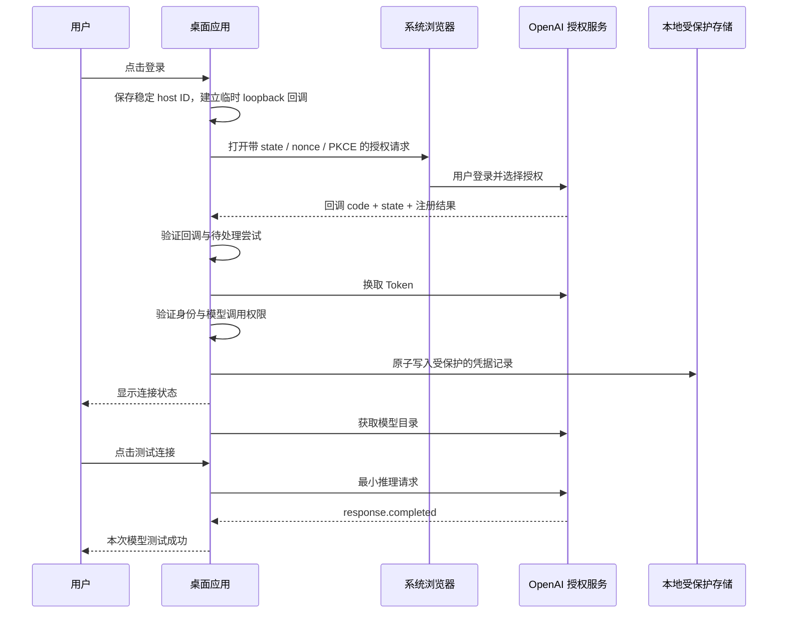

# 从零登录与凭据生命周期

状态：Archived  
最后更新：2026-10-13  
关联文档：[认证 ADR](../03-architecture/adr/0002-auth-provider.md)、[数据模型](../03-architecture/data-model.md)、[安全边界](../03-architecture/threat-model.md)

## 两类凭据

上游 OAuth 凭据只留在桌面应用，用于模型服务。网关密钥由 Tiny Proxy 自己生成，只用于其他设备访问本机 API。两者不能替换；不向客户端返回 access_token、refresh_token、id_token 或授权回调信息。

## 候选登录路线

推荐应用自身身份的 Sign in with ChatGPT（SIWC）→ 公共 Responses。参考项目的设备授权 → Codex 专用端点独立记录，不自动启用、不导入其 Token、不复制其客户端身份。

官方当前提供公共客户端注册、浏览器回调和模型调用权限流程；实际资格和模型范围由 P0 验证。[注册与登录](https://developers.openai.com/siwc/token-sharing-open-source/sign-in)

## 首次登录时序

浏览器由用户完成账号登录。新尝试不覆盖原活动连接，校验失败后不改变原有可用凭据。

实施参数以官方注册文档为准：首次动态注册取得 issued client_id，后续复用该注册；loopback 使用 127.0.0.1 和固定回调路径；每次使用独立 state、nonce、PKCE；验证 ID Token 签名、issuer、audience、有效期、nonce 及已授予模型权限。不得用单纯 JWT 解码代替验证。

## 拟用端点与注册数据

| 项目 | 本路线的值/规则 |
|---|---|
| 授权入口 | https://auth.openai.com/api/accounts/authorize |
| Code/refresh 换 Token | https://auth.openai.com/api/accounts/oauth/token |
| 发现配置 | https://auth.openai.com/.well-known/openid-configuration；验证 issuer 并取可信 JWKS/撤销地址 |
| 模型目录 / 推理 | https://api.openai.com/v1/models / https://api.openai.com/v1/responses |
| 首次注册 | client_id=dynamic_agent_client；agent_name_hint 使用应用真实名称；稳定 ext_agent_host_id |
| 已有注册 | 使用保存的 issued client_id；注册/工作区/身份一起绑定，不使用首次注册入口换 Token |
| 请求权限 | openid profile email offline_access resource.invoke chatgpt.tokens.use.direct；以实际授予结果判断能力 |
| resource | https://api.openai.com/v1 |
| 回调 | http://127.0.0.1:<本次端口>/auth/callback；授权与换 Token 的 URI 必须完全一致 |

端点均在应用中固定/验证，不允许客户端通过请求覆盖。上述细节属于候选路线，P0 再核对当前官方注册文档后固化；参考 Codex 设备授权端点不与本表混用。

## 本地尝试状态机

Idle → Preparing → WaitingBrowser → Exchanging → Validating → Connected 或 SignedInWithoutInference。

任意等待阶段可进入 Cancelled、Expired、Failed。一次只保留一个登录尝试，默认 10 分钟超时；新的登录尝试须先取消旧尝试。回调一次性消费，拒绝重复、错误 state、不匹配注册和身份。

回调监听与外部模型端口分离：仅本机、随机可用端口、只存在于本次授权期间。回调页面不加载第三方资源，完成后清除可见 URL 中授权参数，禁止记录 query。

## 会话状态与续期

Connected → Refreshing → Connected；暂时网络失败进入 TemporarilyUnavailable；确认凭据不可用进入 ReauthRequired。权限不足单独记为 SignedInWithoutInference。

AuthService 是凭据的唯一读写所有者：

1. 请求到来时检查过期信息；建议在到期前 120 秒刷新，使用有限时钟偏差容忍。
2. 按注册 ID 加刷新锁。其他请求等待同一次刷新，等待可取消、有超时。
3. 锁内重新检查版本，避免排队请求再次刷新。
4. 使用该注册的 issued client_id 和 refresh_token 更新。
5. 整个 Token bundle 经操作系统保护后，在一个 SQLite 事务中与过期时间/版本一起替换。
6. 成功提交后才向请求提供新 access_token；刷新失败不覆盖有效旧记录。
7. 临时网络/5xx 保留记录；确认 invalid_grant 等终态后要求重新登录，不能循环刷新。

官方要求同会话刷新串行化并保存最新轮换 Token；账号注册不得混用。[账号与会话](https://developers.openai.com/siwc/token-sharing-open-source/profiles-and-sessions)

单实例锁是跨进程防竞争第一层。未来若引入独立服务，必须重新设计刷新所有权，不能复用当前假设。

远端已轮换但本机在持久化前崩溃，是无法靠本地事务完全消除的窗口；恢复时报告需重新登录，不尝试重复使用已失效 refresh_token。

## 401 与重试

先区分本机密钥错误和上游授权错误。对确认为过期的上游 401，可刷新一次并在尚未输出、请求被明确拒绝的前提下重试一次。无调用权限、地区/工作区限制、已撤销会话和普通超时不走无限刷新。

推理请求的网络失败不自动重放。模型目录 GET 可以有限退避重试；轮换型刷新请求结果不明时不盲目重试。

## 退出、切换、删除

- 切换：只影响新请求，切换模型目录；已有请求保持原注册。
- 退出某连接：拒绝并取消其请求，暂停刷新，尝试远端撤销，再清除本地 Token；保留注册映射供重新登录。
- 远端撤销失败：本地仍可退出，但显示“本地已退出，远端撤销未确认”，提供官方账号设置入口。
- 删除连接：按退出流程后删除元数据，并说明本地逻辑删除的限制。
- 不提供自动凭据导出/同步，不读取 Codex auth.json。

权限未授予时，不静默改用 API Key 或其他账号；恢复动作按官方错误码与用户操作处理。[错误恢复](https://developers.openai.com/siwc/token-sharing-open-source/errors-and-recovery)

## P0 放行条件

干净应用数据目录完成浏览器登录、模型目录、一次明确完成的文本推理、真实函数工具往返。模型列表成功不等于推理成功；文本成功不等于 Agent 工具兼容。未经这些证据，不把认证候选标记为已验证。

本历史版本已由 [Codex 路线决定](../03-architecture/adr/0003-codex-device-gateway.md) 与当前认证/实现文档替代。
